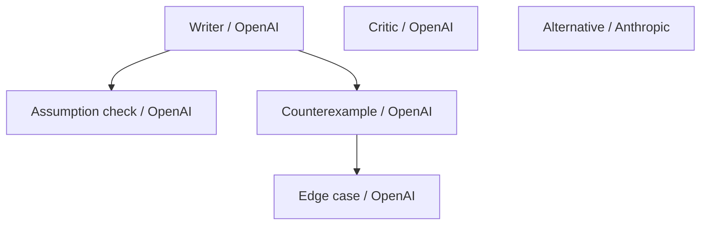

# Agents and subagents

Status: required design for the first live version, not an implemented runtime.
See [requirements](requirements.md), [technical design](technical-design.md), and
[API](api.md).

## Identity and configuration

A provider is a registered integration; OpenAI, Anthropic, and Gemini are the
initial targets rather than a closed list. A model profile is a server-configured
model choice and its capabilities. An execution backend implements provider API,
SDK/CLI, or other tool execution. An agent is a named member
with its own ID, role, task, and execution state. Provider/model is not identity.

Users can add multiple agents with the same provider, the same profile, or different
profiles from one provider. They remain separately addressable. Select the
synthesizer by agent ID, not provider name. Example profile aliases are illustrative:

| Agent | Provider | Profile | Role |
| --- | --- | --- | --- |
| Writer | OpenAI | openai-general | Develop an initial answer |
| Critic | OpenAI | openai-review | Challenge unsupported claims |
| Alternative | Anthropic | anthropic-general | Develop another approach |

Writer and Critic can also use the same profile. The browser selects server catalog
entries, never keys or arbitrary model IDs. All three adapters need a compatible
delegating profile for the first live release; exact model compatibility is unverified.

## Agent tree

User-configured participants are roots. Every eligible root or child may request
bounded subagents and registered tools. Proofestra manages its own tree across
adapters and can delegate to approved native agent backends. Native subagent
capability differs by backend/version; it is not uniform recursive support.
See [tool routing](tools.md) and [documented provider capabilities](provider-capabilities.md).

Each runtime node has a run-scoped unique agent ID, parent ID or null, root ID,
depth, model profile, concise task, and status. Roots have depth zero. The server
derives ancestry from the caller; models cannot reparent, create cycles, or
impersonate roots. Children inherit the parent's profile by default. Other profiles,
including another provider, require the user's run-level allowlist. Before Live
submission, disclose every possible root/helper provider destination.
Native runtimes may have additional internal agents that the harness cannot
observe. Label that coverage explicitly; a managed-node quota is not a claimed
limit on an opaque native tree. Strict policies exclude incompatible routes.

## Spawn and return

1. An adapter emits an internal spawn_subagent request with tool-call ID, concise
   task, optional name, and optional allowed profile. The request cannot create
   permissions. Eligible tools use inherited task grants under [tool policy](tools.md).
2. Validate active caller/run, allowlist, depth, node/child quotas, context fit,
   deadline, and shared call/output allowance.
3. Atomically assign ancestry, reserve capacity, persist the accepted request/event,
   and enqueue. Deduplicate by run + parent agent + parent step + immutable parent
   invocation ID + provider tool-call ID. A provider-local tool ID may repeat in a
   later invocation; that is a different request, still subject to lifetime quotas.
   Matching payloads recover the original decision; changed payloads under that
   key are rejected without creating another child.
4. Mark the parent step waiting_for_children and release global and provider
   execution slots. A waiting parent cannot hold the slot its child needs.
5. Run scoped child tasks and return concise outputs/status as inert tool-result data.
6. After the accepted batch is terminal, resume the parent under its reserved
   continuation capacity. This is another counted harness provider request. Group returned
   tool requests by parent invocation ID; child results from that response share
   one continuation. Duplicate callbacks cannot resume that batch twice.

Only the user adds roots. Model output cannot change policy, credentials, tools,
or allowed profiles. There is no public model-controlled spawn endpoint.
Automatic tool routing that creates a managed child must follow this same
admission path and the helper enablement setting. A direct tool/backend job uses
its own tool policy; native internal delegation also needs supported controls or
explicit admission under native policy. Helpers off requires suppressing native
helpers or excluding the route; bounded-job admission cannot override that setting.
Tool enablement cannot silently override helpers or an existing permission boundary.

## Independence and context

Roots share the same frozen visible conversation. Children inherit it plus their
task and permitted own-branch artifacts. While drafting, no branch sees another
root's current drafts or children. Peer-review access starts only after the root
draft barrier. A root draft waits for its descendants and parent continuation.
Descendants can narrow their parent's permissions but cannot broaden them.

Reviewers and the synthesizer may also delegate. Child results return to parents;
they are not additional root reviewers, independent votes, or evidence of truth.
Same-provider/model agents can share errors despite separate prompts.

Check actual child tasks/results against configured safe model capacity before
spawn/continuation. Never silently trim history or omit results to fit. Deny an
unsafe spawn; preserve partial material if accepted work later cannot finish.
Tasks/results are inspectable outputs, not private chain-of-thought.

## Shared personal defaults

These finite defaults are configurable server policy, not product-wide ceilings
or measured capacity. Runs cannot exceed their deployment's advertised ceilings.
See [scaling](scaling.md) and [tool accounting](tools.md#accounting-and-cancellation).

| Limit | Default |
| --- | --- |
| Root agents | Quick: one; Team: two to six |
| Total accepted agents / spawned agents | Twelve including roots / six children per run |
| Direct children per agent / maximum depth | Two over its lifetime / two, roots at zero |
| Observable harness provider requests | Thirty-two, including visible descendants, parent continuations, and retries |
| Observed tool operations / native jobs | Sixty-four / four; internal usage may be unknown |
| Per-native-job ceiling | 120 seconds, within the overall deadline |
| Global / per-provider concurrency | Three / two, shared across every profile of a provider |
| Overall / direct-request or launch-ack deadline | 300 / 45 seconds |
| Per-call / aggregate output allowance | 2,048 / 65,536 tokens |

Quick defaults to helpers and tools off, one request, no retries. Enabling either
uses the shared request budget and clearly labels the added capability; there is
still no root peer review. Team enables tools and delegation by default, but
agents need not use them. Users can disable either.

The small all-peer Team base plan is 2n+1 root requests: seven for three roots. Two child calls
plus one parent continuation make that example ten, not seven. Show base plan,
reservations, actual dispatched calls, and maximum separately; no fixed cost is implied.
Tools and native jobs have separate ledgers. One CLI job or hosted request can
contain several hidden operations; never equate it to one total model call or
show unknown internal tokens/cost as zero.

Before accepting children, preserve remaining nominal root-stage capacity and a
parent continuation. Reserve calls/output atomically; unknown usage keeps conservative
output reservations. Accepted nodes count toward lifetime quotas even after they
finish, fail, or are canceled. No unlimited replacement children.

Denied spawning creates no child or additional child call. The requesting invocation
still counts and may be billed; any later parent continuation also counts. Return
a typed reason: disabled, profile_not_allowed, depth_limit, agent_limit, child_limit,
call_budget, output_budget, deadline, context_too_large, or invalid_request. Preserve
denials in the run record. Parents must be able to finish without unavailable helpers.

## Failure, cancellation, and storage

An accepted child failure makes the run partial even if its parent recovers. A
denial alone does not fail the run; retain its notice/limitation. Keep existing
root failure rules and never silently replace the selected synthesizer agent.

Stop cancels every active node and prevents new children/continuations. Unrecoverable
parent termination cancels descendants. Late callbacks cannot alter canceled state;
sent provider work may still be billed. Restart interrupts active/waiting nodes
without automatic resumption. Spawn deduplication survives restart.
Native jobs also require supported local process-tree/remote interruption.
Completed effects cannot be rolled back by Stop. Record uncertain external
completion separately; reconcile it before retrying side effects. Later usage
reconciliation cannot reopen a terminal run or resume a parent.

Export includes ancestry, concise tasks/results, profiles, accepted/denied delegation,
stage outcomes, safe tool routes/grant references, and usage with coverage. Terminal-run deletion cascades through the
tree. Exclude keys, raw provider payloads, and private reasoning.
