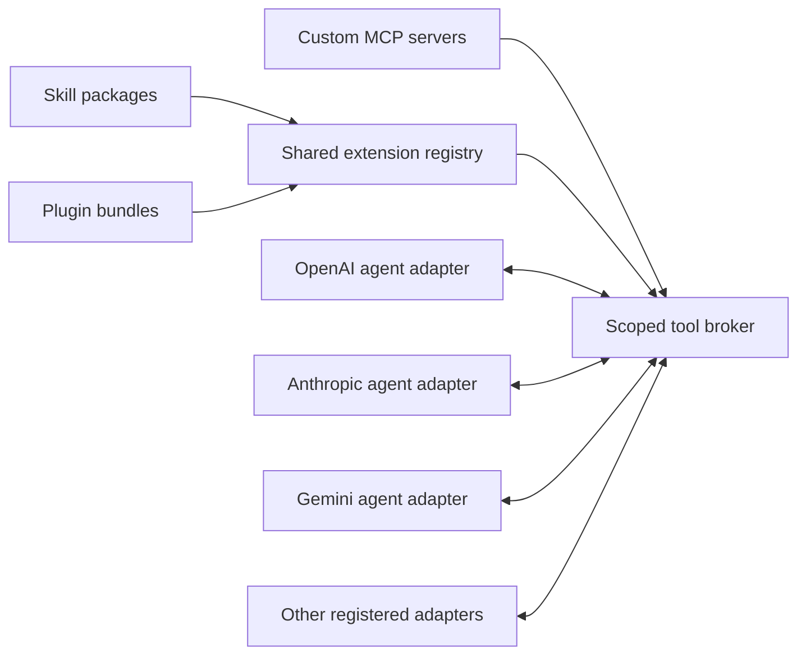

# Shared skills, plugins, and custom MCP

Status: confirmed product scope and proposed design, 17 October 2026. No extension
manager, skill loader, plugin runtime, or MCP broker is implemented. The prototype
uses fictional registrations and results. See [requirements](requirements.md),
[tools](tools.md), [API](api.md), and [provider capabilities](provider-capabilities.md).

## Register once, use across connected providers

The user should be able to register skills, plugins, and custom MCP servers in
Proofestra and make them available to every connected provider. Shared means one
harness-owned registration, namespace, version, and permission boundary. It does
not require a separate native installation in each vendor application.

Every connected provider is eligible for the same enabled catalog within the
user's task/workspace policy. The chosen model/backend must still be able to
receive skill context and call a compatible tool projection. A restricted profile
can use an approved capable helper when helpers are enabled; otherwise report the
unsupported capability. Never silently replace the chosen root or synthesizer.

## Three extension types

| Type | What it contributes | What makes it usable across providers |
| --- | --- | --- |
| Agent skill | Task instructions, metadata, references/assets, optional scripts | Harness-controlled discovery and scoped instruction/resource loading, independent of native skill menus. |
| Plugin | A versioned bundle of skill/tool/MCP/backend declarations | Normalize supported manifest fields into the shared registry; execute code only through a controlled executor. |
| Custom MCP server | Declared remote/local tool capabilities and possibly resources/prompts | A harness MCP client/broker maps supported capabilities into each provider adapter's function interface. |

A skill is not itself an executable tool or a permission grant. A plugin's
description, declared permissions, or bundled hook cannot grant authority. A
custom MCP registration does not expose its authentication to model providers.

## Skill loading

Target the [Agent Skills format](https://agentskills.io/specification): a skill
directory contains `SKILL.md` metadata/instructions and may include scripts,
references, and assets. Its experimental `allowed-tools` field is not accepted as
Proofestra authorization. Validate supported fields and compatibility before import.

The [client integration guide](https://agentskills.io/client-implementation/adding-skills-support)
describes file access, a dedicated activation tool, or programmatic instruction
injection. Proofestra's proposed portable path is a scoped loader: give an agent
relevant skill metadata, activate the selected immutable version, and load only
needed resources. Models need no direct access to the host filesystem.

Track activation ID, agent/branch, package/version/digest, content/resource IDs,
and context placement. Deduplicate repeated activation. Explicit user selection
and permitted model-driven selection use the same loader. Check the combined
skill/context budget before loading; do not silently trim frozen history or
activate different hidden skill versions for peer roots. Record which skills
each root used so differences in task instructions remain inspectable.

Read skill content as bounded task guidance under the user's request and run
policy. Referenced files stay inside approved package/resource roots; scripts
need a separately eligible executor, arguments, dependencies, and matching grant.
Reading a script does not execute it. Relative paths are resolved by the loader,
not arbitrary model-controlled host paths. Skill loading is recorded separately
from executable tool operations and any additional model continuations.
If loading requires a counted executor or model continuation, that work still
consumes its normal ledger allowance; a skill-read counter is not a budget bypass.

## Plugin packages and lifecycle

The proposed Proofestra manifest records a stable package ID, manifest version,
package version and immutable content digest, source/license metadata, contributed
skill/tool/server/backend IDs, dependencies, supported import adapter, and requested
scope. This is a harness format, not a claim that every vendor's plugin manifest,
hook system, UI extension, or authentication can run unchanged.

Users can add trusted local packages or explicitly selected remote sources,
inspect contributions and requested scope, then enable them globally or for a
workspace. The first implementation may use operator configuration; a package
management UI/API follows its own design. No model-driven install endpoint is
created by the read-only catalog contract. Import/metadata validation must not
execute install hooks, package scripts, or fetch arbitrary dependencies silently.
Disabling a bundle removes its own contribution bindings, not unrelated bindings
to a shared skill/server. Dependency ownership and global/workspace activation
must be explicit so one plugin cannot disable another workflow's registration.

Updates preserve package identity and registration, validate a new immutable
version, and replace the active binding atomically. Maintain one discovery-active
version per package/scope; do not create duplicate active plugins or skill names
as an update workaround. Retained content-addressed old versions are history,
not another default registration. A pinned run can use a retained version only
while that exact version remains explicitly enabled and authorized for it.

Freeze extension versions/digests with the run's catalog. Upgrades never silently
mix content into an existing run. Disabling, revoking, removing, or superseding
an eligible version blocks pending loads/calls unless an old version was explicitly
retained for that run. Stop affected work where supported and preserve uncertain
external completion. Re-enabling does not automatically replay an interrupted job.

## Custom MCP broker

Users register a server identity and supported protocol/backend version, local
STDIO launch or remote Streamable HTTP endpoint, required capabilities, tool
allowlist, workspace/resource/egress constraints, and backend-only auth reference.
Legacy SSE is an explicitly supported/tested adapter, not an assumed fallback.
Custom local/private endpoints are permitted when explicitly configured; endpoint,
redirect, and resource checks must not silently expand the authorized destination.

The MCP [transport specification](https://modelcontextprotocol.io/specification/2026-07-28/basic/transports)
defines STDIO and Streamable HTTP. The current revision carries protocol metadata
per request; older revisions have different initialization/session behavior.
Pin and test the broker's supported protocol family rather than assuming one wire
lifecycle across every native SDK or hosted connector.

The [MCP tools specification](https://modelcontextprotocol.io/specification/2026-07-28/server/tools)
defines paginated discovery and schema-described invocation. Tool names are scoped
to their server, and server-provided names do not uniquely identify registrations.
Proofestra therefore assigns stable registration IDs, namespaces contributions,
and treats descriptions/annotations/results as untrusted data. Cached catalogs
remain bound to their configured server, version, authorization scope, and freshness.

The broker owns server launch/connection, authentication, bounded discovery,
argument/result validation, timeouts, cancellation, and safe result normalization.
Secrets stay in supported backend stores, with references in configuration.
Do not distribute tokens, environment variables, credential files, or launch
commands through model prompts or browser catalog responses. Redact credential-bearing
URL userinfo/query values from metadata. Remote authorization
follows the selected MCP version and server's [documented auth flow](https://modelcontextprotocol.io/specification/2026-07-28/basic/authorization).
Registering one user-authorized connection can serve permitted agents without
making each model vendor sign into that server.

MCP [tools, resources, and prompts](https://modelcontextprotocol.io/docs/2026-07-28/learn/architecture)
are distinct capabilities. Map only declared,
tested operations; unsupported features remain unavailable. Resource access still
needs scope checks, including links returned by tools. Prompts are guidance, not
grant decisions. Elicitation, legacy sampling, browser flows, or other additional features
need their own compatible policy; a server cannot obtain the harness's model
credentials, approval credentials, or unrestricted filesystem by requesting them.

## Function bridges and compatibility

Logical tool IDs use `ext.<stable-registration-id>.<local-id>`. Display names are
not identity. Per-provider wire aliases must meet that provider's name/schema
constraints, remain collision-checked, and map back to the exact logical ID,
version, scope, and input schema. Two servers exposing `search` stay distinct.

For a tool-capable model, its adapter presents a bounded relevant set of function
definitions and converts selected calls into the existing internal tool request.
The broker executes the custom tool and the adapter returns a supported result.
If a provider supports a suitable native MCP route, it is an optional tested
projection with the same effective policy, not a prerequisite for shared access.
Do not drop schema constraints or convert unknown binary/resource content into
fabricated text to claim compatibility. Report an incompatible projection or use
an approved capable route. Count every additional visible request/continuation.

Provider-exclusive hosted tools do not become portable merely by registering them.
A suitable approved provider helper can return a result to another agent through
the harness; vendor tool credentials, opaque state, and private reasoning stay
within their own backend. That remains delegation, not direct native parity.

## Scope, isolation, and observability

Global/workspace enablement controls catalog visibility. Run/agent selections and
task grants can narrow it. Import and enablement are not permission to execute
every contributed action. A shared plugin/server can expose different authorized
subsets to different agents; the UI explains compatible, disabled, missing-auth,
blocked, stale-version, and unsupported states.

Shared registration does not mean shared scratch state, handles, current drafts,
or private results across independent roots. Keep per-run/root-branch execution
state and artifact scope. Common pre-existing read-only sources may be used by
every root; current peer artifacts remain inaccessible until the review barrier.
Derive caller/run/branch identity server-side; a model argument or returned handle
is not proof of authority to another branch's state.
An MCP/backend unable to enforce required isolation is ineligible for that stage.
Broker pools must not mix grants, credentials, workspace state, or mutable handles
between branches merely because they use the same connection.

Reuse existing scoped grants without repeated prompts. Check current revocation,
version/digest, schema, destinations, and allowances before every load or dispatch.
Missing scope pauses the concrete action within frozen allowlists. Neither a
skill nor a plugin can approve itself, enable a server, install dependencies,
switch providers, or bypass disabled helpers. Approval controls remain outside
agent-controlled browsers and processes.

Safe records/export include extension and contribution IDs, immutable versions,
activation/routes, provider/agent/branch, grant references, concise results and
usage coverage. Exclude secret configuration, private reasoning, and raw traces.
Do not automatically copy all skill bodies or plugin assets into portable exports;
include safe provenance and authorized content under retention/license policy.
The Apache 2.0 core covers the loader, registry, adapters, and broker; imported
third-party packages and remote services keep their own terms.

## Acceptance and implementation order

EX-01–EX-08 and A21–A25 in [requirements](requirements.md) track this scope.
Start with deterministic skill/plugin/server fixtures in the shared registry and
function bridge; prove multi-provider reuse, branch isolation, grants, naming,
version changes, missing auth, and cancellation without live calls. Then validate
real skill import and custom MCP transports before promoting native format imports.
Check user-facing enablement and update behavior separately from tool dispatch.
No packages or custom servers have been installed during this design work.

Research above uses official Agent Skills and MCP sources checked 17 October
2026. The bridge, manifest, lifecycle, and permission choices are Proofestra's
proposed design; the standards do not establish that those controls are implemented.
