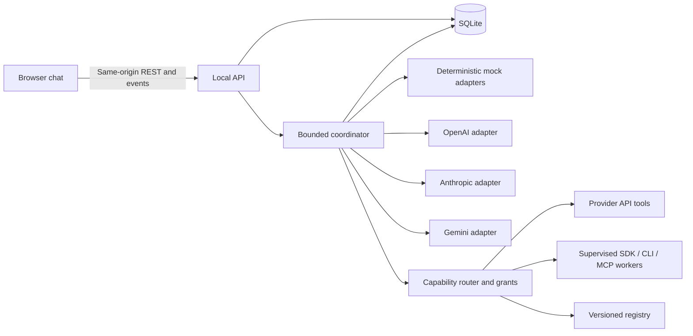

# Technical design

Status: proposed design, 17 October 2026. No application backend or API is implemented.
See [requirements](requirements.md), [experience](experience.md), and [API](api.md).
The canonical identity, delegation, and shared-limit policy is in
[agents and subagents](agents.md). [Tool routing](tools.md),
[provider capabilities](provider-capabilities.md), and [scaling](scaling.md)
define execution backends and configurable capacity.

## Deployment and stack

Design default: TypeScript throughout; React with Vite for the chat interface;
Fastify on Node.js for the API, static assets, and bounded run coordinator; SQLite
for local persistence. Use one long-lived server process on one machine. Build
the client into static assets served by the same origin. No external database,
queue service, account system, or commercial service is needed for the core.

This is a recommendation for personal self-hosting, not an installed stack. Pin
supported package, adapter SDK, and Node LTS versions with a lockfile when building.
The standalone prototype has no runtime dependencies and is separate from this stack.

| Choice | Reason and tradeoff |
| --- | --- |
| React + Vite | Interactive UI with static build output; requires a client build. |
| Fastify | Explicit HTTP validation and long-lived scheduler boundary; more setup than a full-stack UI framework. |
| SQLite | Simple local persistence for one owner; multiple instances and network-mounted databases are out of scope. |
| REST + server-sent events | Ordinary writes and replayable one-way progress; token-by-token streaming is later. |
| Versioned execution adapters | Initial three provider APIs, then tested native SDK/CLI/MCP workers; each requires compatibility and policy fixtures. |

References checked during design: [Vite](https://vite.dev/guide/),
[Fastify](https://fastify.dev/docs/latest/Reference/Server/),
[SQLite deployment guidance](https://sqlite.org/whentouse.html), and
[SSE](https://developer.mozilla.org/en-US/docs/Web/API/Server-sent_events/Using_server-sent_events).
These establish platform capabilities; the architecture is our design choice.

## Components

Future layout: `src/web`, `src/server`, `src/core`, `src/providers`, `src/tools`,
`src/backends`, `src/storage`,
and `tests/fixtures`. These directories are not scaffolded yet. Keep orchestration
independent of the HTTP framework. Adapters accept normalized text, an explicit
model ID, output ceiling, deadline, and abort signal. They return text, concise
review findings, available usage, and typed errors. Validate provider output as
untrusted data; never request or retain private chain-of-thought or raw HTTP traces.
Normalize bounded spawn_subagent requests, tool requests, and safe results through
adapters. Proofestra owns its managed tree; native child support varies by backend.
Keep opaque native tree/call coverage distinct from harness-managed records.

Provider/profile IDs are open registry strings. A registration declares supported
model/API/transport versions, readiness, schemas, auth references, execution
location, grants/egress, cancellation, usage visibility, and enforceable bounds.
Page/filter the catalog and load relevant authorized tool schemas lazily.

The router prefers a compatible current-profile tool, otherwise an approved
capable helper/backend. Snapshot registry/policy versions and route reasons.
Creating a managed helper obeys the delegation setting and tree quotas. Helpers
off requires suppressing native helper spawning or excluding the route; bounded-job
admission cannot override it. A native job does not imply permission for unrestricted internal delegation. Missing scope
pauses the concrete action; matching existing grants execute without repeated
prompts. Never add a provider, sign in, install software, or change the selected
root/synthesizer as an implicit fallback. See [tool policy](tools.md).
Freeze initial grant references and allowlists, recheck validity/revocation before
dispatch, and record exact-action user decisions for missing scope within frozen
routes/destinations. Broader allowlist changes need a new configured run.

## Workflow

Agent identity is independent of provider/model profile. Users may configure
multiple named agents with the same provider, identical profiles, or different
configured models from one provider. Team defaults to two to six roots; the default is
one each from OpenAI, Anthropic, and Gemini. Quick has one root, with helpers off
and tools off by default; explicitly enabling either does not imply root peer review.
Snapshot agent IDs, roles, profile/model IDs, frozen context, delegation allowlist,
prompt versions, destinations, and limits at run creation.

1. Draft concurrently from the same relevant user context without seeing current peer drafts.
2. After drafting ends, each eligible agent reviews the other successful drafts.
3. One selected root agent synthesizes drafts and concise findings,
   preserving material disagreements, uncertainty, and missing stages.

One small all-peer review round has a base plan of `2n + 1` root requests: seven for three
roots. Children, tools, parent continuations, and retries increase visible work inside
the same budget. Helpers return work to parents and never count as extra root
reviewers. Synthesis targets an agent ID even when roots share provider/model.
No vote or completion badge establishes truth. Model-proposed citations remain
unverified. Tool retrieval status is separate from a recorded claim-support check.
Larger bounded review graphs/hierarchical synthesis are extension points; reject
oversized requests until the selected topology is implemented and fits context.

Eligible roots and children can delegate during drafting, review, or synthesis,
within depth limits. Persist server-derived ancestry and deduplicate spawn delivery.
Waiting parents release global/provider slots. Resume each parent only after its
accepted batch ends. Each root branch stays isolated from current peer drafts
until review; a child finishing cannot bypass the root-draft barrier.

Context policy `all_history_v1` freezes all preceding user/final-assistant turns
and the new prompt, recording their message IDs in the run/export. No hidden
summarization, provider-specific trimming, or memory retrieval occurs. Before
dispatch, check each selected model's configured safe input capacity, including
instructions, reserved output, and worst-case peer artifacts for later stages.
Use local conservative counting when exact counts are unavailable and label the
estimate. Missing safe-capacity configuration blocks Live readiness. If the shared
context cannot fit, reject with `422 context_too_large` and suggest a new chat;
make no provider call. An unexpected later context error yields partial material,
never silent truncation or resubmission with different context.
Children inherit frozen history plus scoped tasks/branch artifacts. Check actual
child tasks and parent tool results before spawn/continuation; refuse unsafe fits
instead of silently dropping history or results.
Backend-specific opaque continuation state stays local to its own backend and is
never replayed as another provider's conversation or exported as private reasoning.

## State and failures

Runs move through `queued`, `running`, `waiting_for_children`, `waiting_for_tool`,
or `awaiting_approval` to exactly one terminal state: `completed`, `partial`,
`failed`, `canceled`, or `interrupted`. Steps: `queued`, `running`, `completed`,
`failed`, `skipped`, `timed_out`, `canceled`, `interrupted`, `waiting_for_children`,
`waiting_for_tool`, `awaiting_approval`. Store workflow status separately from
claim/source status. A completed workflow can still have only unverified sources.

Allow one global active run. A different start returns `409 run_in_progress`;
the same idempotency key and payload recover the existing run. Persist prompt,
run, request digest, key, and initial event atomically, then enqueue. Keep provider
calls outside database transactions. State transitions and their events are atomic.

No successful draft means failure. With one draft, skip peer reviews and allow
a clearly partial synthesis or original-draft fallback. Synthesis failure exposes
labeled drafts, never an invented consolidated answer or an unconfigured provider.
An overall timeout yields partial if a draft exists, otherwise failed. Cancellation
wins atomically against late callbacks; already sent provider work may still be billed.
An accepted child failure makes the run partial even when its parent finishes.
Denied spawns create no child and remain visible notices. Run cancellation stops
the full tree; unrecoverable parent termination cancels descendants and prevents
orphan calls or parent continuations after cancellation.
Tool denial/unavailability is a visible limitation. A failed accepted tool/job or
missing required evidence step cannot be labeled completed verification. Waiting
tool/approval states release local slots. Cancellation stops supervised processes
and requests supported remote interruption without promising rollback. Reconcile
uncertain external effects before retrying them. Terminal state is immutable;
separately labeled later usage/external-status reconciliation never resumes a run.

On restart, mark active runs interrupted and preserve artifacts; never automatically
resume or reissue requests, including waiting parents/children. An event-stream disconnect neither cancels nor duplicates
a run. Reloading recovers its snapshot; reconnecting replays persisted progress.

## Limits and accounting

Personal defaults: 32 observable harness-dispatched provider requests including
visible roots/children/continuations/retries; 64 observed tool operations; four
native jobs; concurrency three globally/two per provider; 300-second overall
deadline; 45-second direct-request/launch-ack timeout; 120-second separately
supervised native-job deadline; 2,048 output
tokens per provider request; 65,536 aggregate requested-output allowance. Every
deadline also respects remaining run time. Quick with helpers AND tools off has
one request and no retries. Managed-agent defaults are six roots, twelve total
nodes, six children, two lifetime direct children per agent, and depth two.

All are configurable finite deployment defaults. Advertise a policy version,
defaults, ceilings, and effective run values through runtime metadata. Reject
requests that exceed policy rather than clamp invisibly. They are not capacity,
speed, spend, or complete-native-tree commitments. The demo editor's six-root
constraint is separate from deployment policy.

Reserve an attempt and output allowance atomically before dispatching each call,
including concurrent batches. Cap subsequent calls to remaining allowance.
Reconcile trusted usage; retain reservations when usage is unknown. Track input
tokens separately. These govern local scheduling and requested output, not a
guarantee about provider billing or enforcement.
Reserve tool/job allowance separately. A native job may contain many internal
calls and tools. Record reported/estimated/unknown internal counts and usage,
without double-counting whole-tree SDK totals and their child events. Unknown
values are null, never zero. Strict policies exclude backends that cannot enforce
a required boundary. An explicitly admitted bounded-job policy can allow opaque
internals under supported job/scope/deadline controls, not an invented inner cap.

Before accepting helpers or retries, reserve remaining nominal root stages plus
child work and the required parent continuation. Waiting parents hold no concurrency
permits. Shared provider limits cover every profile/agent using that provider.
Counts distinguish base plan, reservations, dispatched invocations, and maximum.

At most one retry per logical step across its initial/continuation sequence, only after an explicit retryable rejection before
generation, inside the same limits. No automatic retries for ambiguous timeouts
or requests whose processing status is unknown. Unknown costs remain unknown,
never zero. Dollar estimates need a versioned configured price table; no hard
monetary cap is promised.

## Local persistence

| Record | Fields and invariants |
| --- | --- |
| Conversation | UUID, title, creation/update times. |
| Message | UUID, conversation/run IDs, user/assistant role, text, timestamp, stable sequence. |
| Run | UUID, per-conversation unique idempotency key, normalized request digest, mode, execution mode, model/context snapshot, state, limits, usage, terminal reason. |
| Agent | Run-scoped unique ID, parent/root IDs, depth, name, role/task, profile/model/provider snapshot, status. Repeated provider/profile is allowed. |
| Step/invocation | Unique step ID, run/agent/stage, initial/continuation/retry records, state, reservations, concise output, usage/error. |
| Spawn | Durable run/parent/step/parent-invocation/tool-call tuple, request digest, child ID or denial, task/profile, ancestry and reservation outcome. Continuation is unique per parent-invocation batch. |
| Tool execution/native job | Requester/invocation, capability/tool/backend/profile and versions, validated argument digest, grant references, scope/destinations, reservations, status/artifacts, external completion and usage coverage. |
| Grant/approval | User-authorized scope/expiry/revocation; pending exact action, run/requester/execution IDs, argument digest, decision and durable idempotency record. Never secrets or model-approved grants. |
| Finding/citation | Claim/finding text, origin/tool/source identity, retrieval status/time, separate support-check status/method/limitations. Model citations start unverified. |
| Event | Run, monotonic sequence, type, timestamp, bounded payload; unique run/sequence. |

Use foreign keys, migrations, and short transactions. Keep individual drafts and
review notes as run artifacts; chat history contains user prompts and final
presentations. Do not persist HTTP debug payloads. File permissions are owner-only.

Delete/export require terminal runs in the conversation; active work returns 409.
Deletion cascades through logical messages, runs, agent trees, spawn/tool/job and
approval records, artifacts, events, and idempotency keys. Shared configuration
grants remain subject to their own lifecycle. Explain external/remote artifact
cleanup separately rather than claiming local deletion removes vendor state.
It does not guarantee forensic erasure of SQLite pages, backups, browser copies,
downloaded exports, or provider-side data.

## Security and provider setup

Default loopback listener and canonical origin: `http://127.0.0.1:3000`.
Validate Host, disable CORS, and require matching Origin plus CSRF token for writes.
Use an HttpOnly, SameSite=Strict local session cookie, Secure under HTTPS. This
is a local-browser boundary, not multi-user authentication; trusted local processes
can access it. Public/LAN exposure needs a later authentication/deployment design.
Isolate approval credentials and the approval control surface from agent-controlled
browsers/CLIs. Ordinary local session/CSRF checks cannot establish a human decision
when a tool can drive that same authenticated page; test this boundary explicitly.

Keys and a catalog of model profiles come from server configuration, with no browser
key editor, database key storage, or exported credentials. The UI shows configured
status, not verified provider availability. Live calls require server enablement
and explicit Live selection. Startup and default tests make no provider requests.
Any remote catalog refresh must be a distinct configured operation, following
destination policy; no hidden billable inference or credential discovery.

All three adapters, repeated-provider teams, and bounded delegation belong in the
first live milestone. Profiles may expose multiple explicit model IDs per provider;
never use moving latest defaults. Check delegation capability before enabling it.
Use supported backend-specific auth references, not browser login scraping or
cross-surface token reuse. Supervised SDK/CLI workers use registered executables,
argument arrays, scoped directories, and tested permission hooks. Constrain
hosted tools before dispatch; exclude them when a required approval boundary
cannot be enforced before execution. Do not treat unrestricted CLI mode as a
permission bridge. Raw backend continuation state stays backend-local.
During implementation, check authentication,
capabilities, output limits, usage, retention, and errors against current official
provider documentation. This phase validates no vendor API integration.

Render sanitized Markdown/text, reject raw HTML and unsafe URL schemes, and apply
a restrictive content security policy. Exports contain user text: disclose before
download. No telemetry by default; infrastructure logs omit sensitive content.

## Build sequence

Mock flow and persistence → contract/concurrency/routing checks → three opt-in
live API adapters and validated tools → tested SDK/CLI candidates and larger-team
plans → measured evaluation against single-agent baselines. See [roadmap](roadmap.md) and
[evaluation](evaluation.md). Every component above stays in the Apache-2.0 core.
